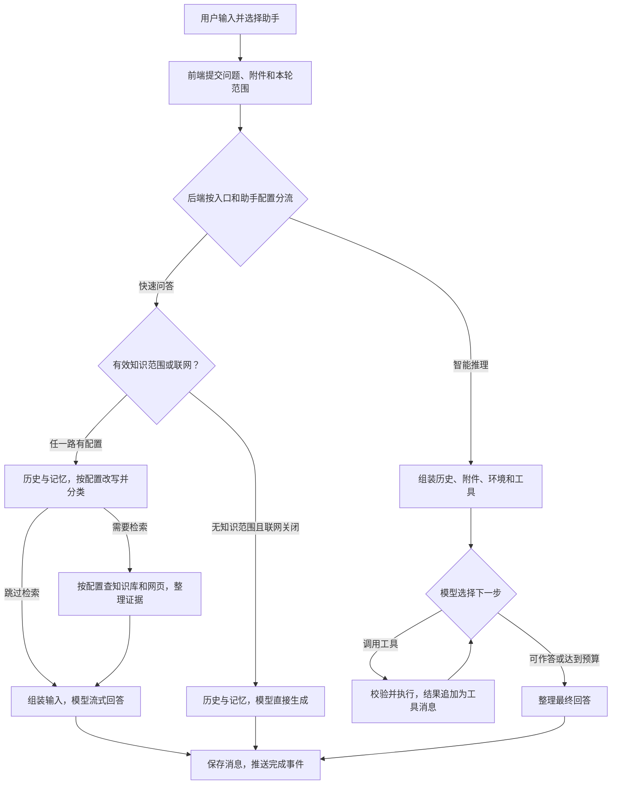

# WeKnora 的 Agent 与 RAG 编排

本文以本地 `D:/Workspace/WeKnora` 的 `main` 为准，版本文件为 `0.9.0`，源码固定在 `cbdcebabf48c5ee2d6868b370326aa8341703f62`。WeKnora 的三条产品能力是知识检索问答、可调用工具的智能推理，以及将资料整理成 Wiki。下文重点是前两条。Wiki 随知识库内容变化触发整理任务，有自己的摄入和更新流程。 [项目介绍][readme] · [Wiki 摄入][wiki]

## 1. 三个决定各发生在哪里

| 决定 | 位置 | 决定什么 |
| --- | --- | --- |
| 外层模式分发 | 前端所选助手、后端两条 QA 入口 | 选 `KnowledgeQA` 还是 `AgentQA`。服务器依据配置校验和分发 |
| 显式意图分类 | `KnowledgeQA` 的检索型流水线，检索前的 `QUERY_UNDERSTAND` | 改写问题、输出 `intent`，影响是否检索和使用哪类回答提示词 |
| 单步行动决策 | `AgentQA` 的每一轮模型调用 | 从允许的工具中选择动作，根据执行结果继续、换一种查法或结束 |

前端整理问题、`agent_id`、`@` 知识库或文件或标签、附件、模型和联网选项。按用户选中的快速问答、智能推理或自定义助手配置发往 `/api/v1/knowledge-chat/:session_id` 或 `/api/v1/agent-chat/:session_id`。普通入口固定走 `KnowledgeQA`。Agent 入口优先应用已解析助手的 `IsAgentMode()`，再看 `agent_enabled`，配置为快速问答时也会走普通管线。模式分发依赖这组配置。 [前端选路][frontend] · [后端入口与配置][mode]

## 2. 快速问答如何调用 LLM

以「上一轮问北京住宿报销，这一轮问那上海呢」为例。

1. **确定本轮可查范围。** 请求显式选择的库、文件或标签与助手配置一起决定可用知识范围。有效范围或本轮生效的联网开关开启时，服务组装检索型流水线。两者都不可用时，服务用历史、记忆及适用的附件等直接调用聊天模型。 [管线装配][qa]
2. **先准备历史，再理解当前问题。** 开启多轮时，按请求 ID 将已存用户和助手消息配对，按完整轮次回放。问题理解插件可结合近期对话、本轮附件、图像标记或视觉输入，以及可用的记忆背景。LLM 一次给出 `rewrite_query`、`intent` 和适用的 `image_description`。本例改写为「上海出差的住宿报销标准是什么」。关闭改写且没有图像时跳过该调用。 [加载历史][history] · [问题理解][understand] · [输入组装][understand-input]
3. **意图决定是否执行检索阶段。** `kb_search`、`clarification` 与空标签启用检索。未知标签会被归为空标签。`web_search` 取决于本轮生效的联网开关。问候、闲聊、总结、衔接已有对话、图片或本轮文档问答等标签可以跳过检索，并应用对应提示词。`doc_only` 可用已准备的本轮附件内容。`@` 已入库文档则是缩小检索范围。配置决定真正能查的来源，因此 `kb_search` 和 `web_search` 不会把知识库和网页强制切开。 [标签和门控][intent] · [附件 Prompt][attachment] · [检索来源分发][search]
4. **准备回答证据。** 需要检索时，以改写后的查询召回资料，视配置执行重排或读取网页，合并、补齐和截断候选。最终模型拿到系统指令、适用的历史和记忆、当前问题以及筛好的证据。检索时用改写后的查询，最终问答仍可以用原始问句表达本轮要求。 [证据组装][merge] · [最终输入][answer-input]
5. **流式生成。** 最终回答由聊天模型 `ChatStream` 生成。这次调用没有工具定义。要再次搜索，需要流水线已有相应步骤或分支。参考资料及模型输出经过事件系统进入 SSE。 [生成请求][llm-stream] · [模型配置][answer-options] · [引用事件][refs]

程序按配置和意图安排阶段，可以跳过不需要的调用。开启问题理解时，这条链路可能分别调用改写模型和回答模型，也可能调用 Embedding 或 Rerank。实际调用量取决于本轮的资料范围和配置。

## 3. 智能推理如何调度和继续

进入 `AgentQA` 后，服务组装有效的模型、知识库和工具范围。开启多轮时可从消息恢复历史工具调用和结果，并按 token 预算整理。本轮输入包含问题、引用、图片、附件内容或附件清单，以及可用资源。引擎把系统指令、历史、当前输入和注册工具的 schema 交给模型。共享助手或文档时仍按有效权限和会话边界收窄工具。 [Agent 请求准备][agent-history] · [当前轮输入][agent-input] · [运行上下文][runtime-context] · [工具装配][tool-scope]

同一个上海报销问题，Agent 可能先调用 `search_knowledge`，读到「特殊情况参见附件二」后决定继续读取附件，拿到限制条件才生成答案。也可能因为上下文已经有充分依据而直接作答。引擎执行工具并把结果追加为工具消息，每轮继续提交给模型。`todo_write` 等是可以配置的工具。模型在每一步决定是否使用。引擎控制迭代上限、工具权限、取消和失败处理。达到上限需要收尾时可使用已有证据发起一次禁用工具的调用。 [模型工具契约][think] · [逐轮模型调用][engine] · [工具结果回填][act] · [到达上限后的收尾][finalize]

前端可以重连已有流。遇到启用的人机交互时，运行可保存快照进入 `awaiting_input`，等待用户应答后从同一个助手消息和被阻塞的工具继续。调用方显式停止与 SSE 断线分别处理。这里的应用设计由程序定义，Agent 的下一步动作才由模型结合观察选择。 [继续流与停止][stream] · [交互挂起][suspend] · [恢复执行][resume]

## 4. RAG、联网和没有资料时

**入库是在为以后查询准备资料。** 上传文件或明确导入 URL 会创建知识记录，解析与切块后存入检索索引。在线查询按知识库、文档和标签等权限范围取片段。依可用索引召回向量和关键词候选，两路均可用时用按名次加权的 RRF 融合。回答前还能按配置重排、补邻块或父块、去重和限量。 [解析与切块][ingest] · [知识召回][hybrid] · [融合][rrf] · [合并][merge]

| 场景 | 网页或文档怎么进入最终回答 |
| --- | --- |
| 快速问答的在线搜索 | 搜索提供方返回标题、链接、摘要或可用正文，转换成检索候选。它们可以和知识库候选一起经过后续重排与合并。在开启自动读取、且有相应重排结果时，可抓取前几条网页正文，失败保留摘要 |
| Agent 的在线搜索 | 模型调用 `web_search` 取得摘要，可再用 `web_fetch` 读 URL。`search_knowledge` 工具内部可执行自身的候选融合和重排。不同工具各自返回证据，模型按工具消息综合 |
| 用户明确导入网页 | 由导入任务把 URL 内容变成知识库记录，解析后入库。以后可像其他已入库资料一样检索 |

当前快速问答源码里的临时知识库压缩步骤已注释。在线结果直接转换为候选。搜索网站的排序可以作为初始顺序，应用的筛选和重排看配置，是否出具正文或引用看本轮任务。将找到的外部证据送入模型增强生成，这个过程就是 RAG 的在线部分。 [快速问答网页候选][web-quick] · [读取正文][web-fetch] · [Agent 知识工具][agent-knowledge] · [工具消息][tool-result] · [独立的 URL 入库][url-ingest]

**三种无资料情形要分开。** 本轮根本没有可用知识范围且关闭 Web，可以用历史和模型知识聊天。选择了检索型管线，但显式意图无需取证，可以跳过检索。确实要查却没有找到证据，普通管线可以按配置给固定回复或模型兜底，Agent 可以继续找授权来源或说明未找到。明确依赖私有资料的任务需要如实反映证据缺口。引用与实际检索命中的文档片段或 URL 绑定。 [纯聊和 RAG][qa] · [普通无命中处理][empty] · [Agent 取证规则][grounding] · [引用映射][citations]

## 5. 持久化、标题与后续问题

两条路径共享部分 HTTP 和 SSE 基础设施。先建用户及助手消息，回答、工具事件、引用、标题等经 EventBus 写入 `StreamManager`，SSE 按偏移读。正常完成时先把内容、来源及适用的步骤保存，再发布 `complete`。空标题可在主回答开始时并发生成，后续问题用已完成的回答和本轮配置异步生成，通过建议接口读取。 [消息创建][message] · [流读取][stream-read] · [写入与完成事件][complete] · [并行标题][title] · [后续问题][suggestions]

## 6. 对 ArchFlow 有用的判断

WeKnora 值得借鉴的是把上下文、外部证据、模型决定、实际执行和结果传输分别落到具体模块。快速问答的显式分类细致之处在于同时做改写、处理图片或附件、保留历史，并让标签控制检索和生成。Agent 的工具循环能根据中途证据改变动作。混合检索和证据合并、上下文预算、工具结果回填、可重连与挂起恢复都是工程能力。代码能说明这些机制存在，意图识别准确率和延迟优势还要用固定样本实际测量。

ArchFlow 可以把会话理解前置为两条执行路径共享的能力。由后端根据动作、约束、明确程度和执行条件选择直达或规划。两条路径可同时使用 LLM 和项目知识库。意图样例匹配负责分类，项目 RAG 负责取证，画布对象与版本负责定位及提交。 [ArchFlow 设计稿](系统架构与Agent编排设计.md) · [架构讨论交接](Agent架构讨论交接.md)

[readme]: https://github.com/Tencent/WeKnora/blob/cbdcebabf48c5ee2d6868b370326aa8341703f62/README_CN.md#L41
[wiki]: https://github.com/Tencent/WeKnora/blob/cbdcebabf48c5ee2d6868b370326aa8341703f62/internal/application/service/wiki_ingest.go#L530
[frontend]: https://github.com/Tencent/WeKnora/blob/cbdcebabf48c5ee2d6868b370326aa8341703f62/frontend/src/views/chat/index.vue#L1704
[mode]: https://github.com/Tencent/WeKnora/blob/cbdcebabf48c5ee2d6868b370326aa8341703f62/internal/handler/session/qa.go#L1129
[qa]: https://github.com/Tencent/WeKnora/blob/cbdcebabf48c5ee2d6868b370326aa8341703f62/internal/application/service/session_knowledge_qa.go#L195
[history]: https://github.com/Tencent/WeKnora/blob/cbdcebabf48c5ee2d6868b370326aa8341703f62/internal/application/service/chat_pipeline/common.go#L132
[understand]: https://github.com/Tencent/WeKnora/blob/cbdcebabf48c5ee2d6868b370326aa8341703f62/internal/application/service/chat_pipeline/query_understand.go#L61
[understand-input]: https://github.com/Tencent/WeKnora/blob/cbdcebabf48c5ee2d6868b370326aa8341703f62/internal/application/service/chat_pipeline/query_understand.go#L294
[intent]: https://github.com/Tencent/WeKnora/blob/cbdcebabf48c5ee2d6868b370326aa8341703f62/internal/types/chat_manage.go#L249
[attachment]: https://github.com/Tencent/WeKnora/blob/cbdcebabf48c5ee2d6868b370326aa8341703f62/internal/application/service/chat_pipeline/into_chat_message.go#L93
[search]: https://github.com/Tencent/WeKnora/blob/cbdcebabf48c5ee2d6868b370326aa8341703f62/internal/application/service/chat_pipeline/search.go#L86
[merge]: https://github.com/Tencent/WeKnora/blob/cbdcebabf48c5ee2d6868b370326aa8341703f62/internal/application/service/chat_pipeline/merge.go#L55
[answer-input]: https://github.com/Tencent/WeKnora/blob/cbdcebabf48c5ee2d6868b370326aa8341703f62/internal/application/service/chat_pipeline/into_chat_message.go#L185
[llm-stream]: https://github.com/Tencent/WeKnora/blob/cbdcebabf48c5ee2d6868b370326aa8341703f62/internal/application/service/chat_pipeline/chat_completion_stream.go#L73
[answer-options]: https://github.com/Tencent/WeKnora/blob/cbdcebabf48c5ee2d6868b370326aa8341703f62/internal/application/service/chat_pipeline/common.go#L47
[refs]: https://github.com/Tencent/WeKnora/blob/cbdcebabf48c5ee2d6868b370326aa8341703f62/internal/application/service/session_knowledge_qa.go#L730
[agent-history]: https://github.com/Tencent/WeKnora/blob/cbdcebabf48c5ee2d6868b370326aa8341703f62/internal/application/service/session_agent_qa.go#L215
[agent-input]: https://github.com/Tencent/WeKnora/blob/cbdcebabf48c5ee2d6868b370326aa8341703f62/internal/application/service/session_agent_qa.go#L382
[runtime-context]: https://github.com/Tencent/WeKnora/blob/cbdcebabf48c5ee2d6868b370326aa8341703f62/internal/agent/observe.go#L941
[tool-scope]: https://github.com/Tencent/WeKnora/blob/cbdcebabf48c5ee2d6868b370326aa8341703f62/internal/application/service/agent_service.go#L1318
[think]: https://github.com/Tencent/WeKnora/blob/cbdcebabf48c5ee2d6868b370326aa8341703f62/internal/agent/think.go#L312
[engine]: https://github.com/Tencent/WeKnora/blob/cbdcebabf48c5ee2d6868b370326aa8341703f62/internal/agent/engine.go#L920
[act]: https://github.com/Tencent/WeKnora/blob/cbdcebabf48c5ee2d6868b370326aa8341703f62/internal/agent/engine.go#L1379
[finalize]: https://github.com/Tencent/WeKnora/blob/cbdcebabf48c5ee2d6868b370326aa8341703f62/internal/agent/finalize.go#L76
[stream]: https://github.com/Tencent/WeKnora/blob/cbdcebabf48c5ee2d6868b370326aa8341703f62/internal/handler/session/stream.go#L117
[suspend]: https://github.com/Tencent/WeKnora/blob/cbdcebabf48c5ee2d6868b370326aa8341703f62/internal/agent/hitl/broker.go#L274
[resume]: https://github.com/Tencent/WeKnora/blob/cbdcebabf48c5ee2d6868b370326aa8341703f62/internal/agent/resume.go#L170
[ingest]: https://github.com/Tencent/WeKnora/blob/cbdcebabf48c5ee2d6868b370326aa8341703f62/internal/application/service/knowledge_process.go#L4291
[hybrid]: https://github.com/Tencent/WeKnora/blob/cbdcebabf48c5ee2d6868b370326aa8341703f62/internal/application/service/knowledgebase_search.go#L240
[rrf]: https://github.com/Tencent/WeKnora/blob/cbdcebabf48c5ee2d6868b370326aa8341703f62/internal/application/service/knowledgebase_search_fusion.go#L157
[web-quick]: https://github.com/Tencent/WeKnora/blob/cbdcebabf48c5ee2d6868b370326aa8341703f62/internal/application/service/chat_pipeline/search.go#L703
[web-fetch]: https://github.com/Tencent/WeKnora/blob/cbdcebabf48c5ee2d6868b370326aa8341703f62/internal/application/service/chat_pipeline/web_fetch.go#L44
[agent-knowledge]: https://github.com/Tencent/WeKnora/blob/cbdcebabf48c5ee2d6868b370326aa8341703f62/internal/agent/tools/search_knowledge.go#L255
[tool-result]: https://github.com/Tencent/WeKnora/blob/cbdcebabf48c5ee2d6868b370326aa8341703f62/internal/agent/observe.go#L1105
[url-ingest]: https://github.com/Tencent/WeKnora/blob/cbdcebabf48c5ee2d6868b370326aa8341703f62/internal/application/service/knowledge_create.go#L411
[empty]: https://github.com/Tencent/WeKnora/blob/cbdcebabf48c5ee2d6868b370326aa8341703f62/internal/application/service/session_knowledge_qa.go#L782
[grounding]: https://github.com/Tencent/WeKnora/blob/cbdcebabf48c5ee2d6868b370326aa8341703f62/internal/agent/grounding_prompt.go#L54
[citations]: https://github.com/Tencent/WeKnora/blob/cbdcebabf48c5ee2d6868b370326aa8341703f62/internal/modelcontext/citations.go#L219
[message]: https://github.com/Tencent/WeKnora/blob/cbdcebabf48c5ee2d6868b370326aa8341703f62/internal/handler/session/qa.go#L1216
[stream-read]: https://github.com/Tencent/WeKnora/blob/cbdcebabf48c5ee2d6868b370326aa8341703f62/internal/handler/session/stream.go#L363
[complete]: https://github.com/Tencent/WeKnora/blob/cbdcebabf48c5ee2d6868b370326aa8341703f62/internal/handler/session/qa.go#L2212
[title]: https://github.com/Tencent/WeKnora/blob/cbdcebabf48c5ee2d6868b370326aa8341703f62/internal/handler/session/qa.go#L904
[suggestions]: https://github.com/Tencent/WeKnora/blob/cbdcebabf48c5ee2d6868b370326aa8341703f62/internal/application/service/message_suggestion.go#L69
