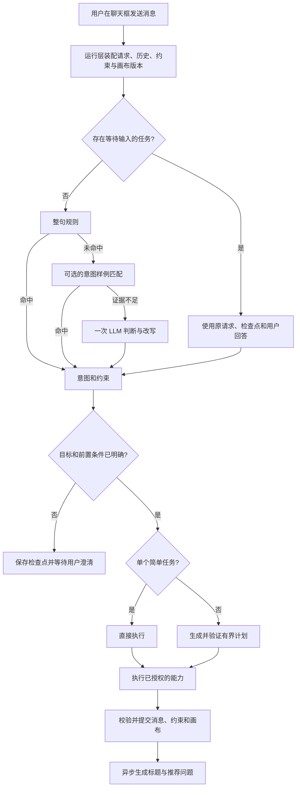

# ArchFlow 架构规划

> 更新于 2026-11-23。Agent 编排以第 10 节为准，交付状态见 [`待做清单.md`](./待做清单.md)。
> 本文只记录**现有设计、已定决策与未来演进边界**；接口字段、枚举、长度等契约仍以 `packages/shared/src/schemas/` 和 `specs/API文档/` 为准。
> 状态标记：✅ 已实现；🟡 已有设计、尚未实现；⬜ 未开始。

## 0. 总览

**当前形态**

- `apps/web` 默认使用已接线的正式 `/api/v1` 工作台，包括账号、会话、SSE、画布布局与资产。显式设置 `MOCK_API=1` 才使用同一工作台路径下的隔离 `/api/mock` 预览。
- `apps/api` 已有正式鉴权、消息受理、SSE、RAG 与原有 Agent 主链路。新增的 `AgentRunService` 是独立持久化服务实现，尚未替换正式 `RunModule` 的 HTTP/SSE 执行入口；新增单活跃 run 迁移文件暂不注册启用，正式运行没有这项数据库约束，激活前需验证现有并发与数据兼容性。
- 新 `packages/agent` 提供级联意图路由、直接执行、有界计划、澄清续跑、图补丁和原生模型适配。正式入口尚未接入这套编排。
- `packages/db` 管理业务实体和数据库迁移。`packages/shared` 提供运行、图数据、编排和前后端接口的 Zod 契约。

**目标形态**

```
模块化单体（NestJS + Agent 进程内）
  + post-MVP：一个 Go 文档解析服务
  + post-MVP：RabbitMQ 异步任务总线
  + PostgreSQL / Redis / MinIO
```

**明确不做**

- 多人协作已退出产品路线，不列为后续扩展。项目仅供所有者访问，不做项目共享、成员邀请、角色管理或多人实时画布同步。草稿冲突检查和历史分支仍保留。
- 不为了简历或“架构完整”把核心业务拆成完整微服务。
- 不引入 BullMQ；未来异步任务统一用 RabbitMQ。
- 不引入 LangChain / LangGraph / Vercel AI SDK。
- MVP 不引入 RabbitMQ、Go 服务、MCP、API Gateway。

**四条原则**

1. 契约驱动：Zod 是前后端唯一真理；跨语言时由 Zod 生成 JSON Schema。
2. 状态外置：run、约束、画布、HITL 中断都必须落库，内存只做加速。
3. 数据库权威：SSE 缓冲只负责逐帧重放，断线恢复以 `runs` / `messages` 为准。
4. 按真实边界拆分：只有资源画像、故障隔离或发布节奏出现真实差异时才拆服务。

---

## 1. 记忆

**现有设计**

- `agent_states` 每个会话一行，保留已确认的结构化约束、进度和版本。等待输入的任务另外保留原请求及中断检查点，以便继续这一轮。
- 上下文窗口保留最近 10 条用户和助手消息，模型适配器再截断单条历史文本。当前输入、结构化约束和画布由运行层单独传入。
- 画布：`conversations.current_draft_graph` 存当前草稿；`messages.graph_snapshot` 存关键快照。
- 项目知识：`documents_chunks` + pgvector，查询强制带 `project_id`。
- 分叉：物理复制消息，并把源消息的 `graph_snapshot` 赋给新会话草稿。

**已定决策**

- MVP 保持“结构化约束 + 最近消息 + 当前草稿 + 项目 RAG”，不做滚动摘要、不做跨会话用户记忆。
- `agent_states` 已增加版本号；数据库“同一会话单活跃 run”唯一约束仍属待激活迁移的设计，启用前须验证正式运行的并发策略与既有数据。
- 新约束与已确认值冲突时，Agent 先询问用户。约束来源的逐项审计可随评测和运行观测补齐。

**未来演进**

- 会话摘要：消息超过窗口后，把旧消息压缩成结构化摘要，写入独立表或 `agent_states`。
- 项目记忆：沉淀已确认的架构决策、技术栈偏好、历史资产，按 `project_id` 检索。
- 用户记忆：跨项目偏好，必须显式授权，且可查看、可删除。
- 检索式记忆：把历史决策向量化，和文档 RAG 分开索引，避免不同来源互相稀释。

### 1.1 上下文预算与压缩窗口（post-MVP）

**现状**：MVP 没有自动压缩，也没有上下文用量指示器。每次组装 Prompt 时只带“最近约 10 条消息 + 结构化约束 + 当前草稿 + RAG 片段”，超出部分直接截断，不生成摘要。

**为什么不在 MVP 做**：压缩会引入新的失真来源。约束、已否决方案、未决问题一旦被摘要漏掉，后续图生成会直接跑偏；而 MVP 的历史长度和成本还不足以证明需要它。

**触发条件**：出现以下任一情况再立项，不为了“功能完整”提前做：

- 单会话消息经常超过模型 `maxContext` 的 60%~70%；
- 首 token 延迟或 token 成本被历史消息明显拖高；
- golden cases 证明“最近 10 条”已经丢失关键约束。

**预算口径**：预算按“单次 LLM 调用的输入上限”计算，不按消息条数。

```
maxContext
  - 预留输出 tokens
  - system prompt + tool 定义（稳定前缀）
  - 当前用户消息
  = 可用于历史 + 摘要 + 约束 + RAG 的预算
```

- 稳定前缀（system / tools / 输出 schema）不压缩。
- 当前用户消息、当前画布、已确认约束不压缩。
- RAG 片段按相关度截断，不进入摘要。
- 优先压缩最旧的消息；压缩后仍超预算，再降低 RAG topK 或最近消息条数。

**摘要结构**：摘要必须是结构化 JSON，不是自由文本。建议 Zod 定义 `ConversationSummary`：

```ts
{
  confirmedConstraints: Record<string, unknown>;
  rejectedOptions: Array<{ option: string; reason: string; sourceMessageId: string }>;
  openQuestions: Array<{ question: string; sourceMessageId: string }>;
  keyDecisions: Array<{ decision: string; reason: string; sourceMessageId: string }>;
  coveredUntilMessageId: string;
  version: number;
  tokenCount: number;
}
```

- 每条摘要结论必须带 `sourceMessageId`，便于回溯。
- 原始消息永久保留，摘要只是派生数据，不能替代 `messages`。
- 摘要生成用独立 Prompt，限制 `max_tokens`，失败时回退到“只截断、不摘要”。

**存储建议**：独立表 `conversation_summaries`，字段至少包含 `conversation_id`、`version`、`covered_until_message_id`、`summary`（JSONB）、`token_count`、`created_at`；`agent_states` 只存当前生效的 `active_summary_id`。不要每轮覆盖同一行，保留版本才能回滚和对比。

**装配顺序**：稳定内容在前，动态内容在后，兼顾缓存命中：

```
system → tools → 输出 schema → 会话摘要 → 已确认约束 → RAG → 最近消息 → 当前用户消息
```

**用户可见性**：UI 只显示“已压缩 N 条历史”的可展开提示，展开后展示结构化摘要；不展示摘要生成过程的思维链。用户删除会话时摘要级联删除。

**评测与回滚**：上线前必须有对照实验，至少看约束召回率、图合法性、引用准确率、无答案识别、首 token 延迟、token 成本。摘要版本保留，出现回归时可切回旧版本或关闭压缩。

**明确不做**：

- 每轮都压缩；只在高水位触发。
- 把工具输出、RAG 原文整段塞进摘要。
- 用摘要替代原始消息，或删除原始消息。
- 在 MVP 做“上下文窗口”可视化仪表盘。

---

## 2. 工具调用

主 Agent 执行 `AgentTask` 白名单中的任务。计划由模型提议，由服务端验证可用能力、目标覆盖和执行顺序。项目知识通过检索接口读取，项目范围由运行层注入。约束从当前上下文读取，图结果交给代码校验，追问由引擎返回 `waiting_input`。模型可以提议 `GraphPatch`，草稿的持久化由运行层统一完成。

现阶段每项能力使用一次结构化模型响应或确定性处理。Function Calling、工具注册和权限审计可在需要真正的外部工具时扩展。

**未来演进**

- 工具注册表支持按节点配置白名单。
- 工具执行器补超时、重试、幂等键、结果截断。
- 接入 MCP 时，MCP tool 转成内部 Tool 定义，复用同一套注册、权限、审计。

### 2.1 Skill 与能力封装（post-MVP）

**现状**：产品没有 Skill 功能。`apps/web` 侧边栏的“添加 Skill”只是静态按钮，没有点击处理、API、Zod 契约、数据库表或 Agent 逻辑；因此不存在“项目级 Skill 与会话级 Skill 是否分开”的实现，两者都还没有。

**与 MCP 的边界**：

- Skill 是提示词片段、工具白名单、输出契约和模型策略的**可复用封装**，属于应用层能力。
- MCP 是外部工具接入协议，属于工具来源层。
- Skill 可以引用允许的 MCP tool，但不能绕过工具权限和 HITL。
- Skill 不是插件市场，也不是多 Agent 编排；MVP 和近期都不做。

**三层模型**：

| 层级 | 实体 | 关键字段 | 作用 |
| --- | --- | --- | --- |
| 项目级定义 | `ProjectSkill` | `projectId`、`name`、`description`、`version`、`promptFragment`、`toolAllowlist`、`outputSchemaRef`、`modelPolicy`、`enabled` | 可复用、可版本化的能力沉淀 |
| 会话级绑定 | `ConversationSkillBinding` | `conversationId`、`skillId`、`skillVersion`、`enabled`、`overrides`（JSONB） | 决定当前会话启用哪些 Skill、覆盖哪些参数 |
| Run 级快照 | `RunSkillSnapshot` | `runId`、`resolvedSkills[]`、`resolvedAt` | 固定本次运行实际使用的版本，保证可复现 |

**解析顺序**：`run overrides > conversation binding > project default`。不引入全局可变的“当前 Skill”；每次 run 创建时解析成不可变快照，写入 `runs.metadata`。

**版本策略**：

- Skill 版本不可变；修改生成新版本，不原地覆盖。
- 会话绑定默认钉住 `skillVersion`，升级必须显式操作，避免历史会话行为漂移。
- Run 快照记录 `skillId + version + hash`，用于回放和问题定位。

**权限与安全**：

- Skill 只能缩小工具白名单，不能扩大项目级权限。
- `destructive` 工具即使被 Skill 引用，仍必须走 HITL 审批。
- Skill 的 promptFragment 属于项目级内容，不进入 system prompt 的稳定前缀；与系统指令冲突时以系统指令和安全规则为准。
- Skill 输出仍必须过 Zod；不能因为“Skill 已定义 schema”就跳过校验。

**契约与接口（未来）**：先改 `packages/shared` Zod，再谈 API。建议资源路径：

```
GET/POST/PATCH /api/v1/projects/:projectId/skills
GET/PUT       /api/v1/conversations/:conversationId/skills
```

响应仍走 `{ code, message, data, errors?, traceId }` 外壳；Skill 的 `enabled`、`version`、`overrides` 必须有明确默认值和校验。

**MVP 处理**：不实现。侧边栏按钮应移除，或改为 disabled + “即将支持”，避免给用户不存在的功能预期。不要把 Skill 塞进 MVP 主链路，优先保证约束提取、图生成、SSE 恢复和 HITL。

---

## 3. MCP

**现状**

- 仓库零引用，没有 MCP client / server。

**已定决策**

- MVP 不引入 MCP。
- 只保留内部 Tool 抽象；未来 MCP 作为 adapter，不改变 Agent 主循环。

**未来演进**

- Client 模式：接入 GitHub、Jira、数据库、浏览器等外部工具；处理进程生命周期、重连、超时、工具名冲突。
- Server 模式：把项目、画布、知识库暴露给其他 Agent；必须做鉴权和租户隔离。
- 安全：外部工具输出视为不可信输入，防 prompt injection，限制权限并审计。

---

## 4. 网关

**现状**

- Next middleware：只做基于 session hint cookie 的路由守卫，不是鉴权。
- NestJS：唯一 API 入口，全局前缀 `api/v1`，CORS 白名单。
- Nginx：规划用于静态资源、HTTPS、SSE 长连接反代。

**已定决策**

- 单体阶段不上 API Gateway。
- Nginx 负责 TLS、请求体大小、SSE `proxy_buffering off` / `proxy_read_timeout`、`X-Trace-Id` 透传。
- 服务间调用必须透传同一个 traceId。

**未来演进**

- 多前端时再考虑 BFF。
- 真正出现多服务、灰度、熔断需求时再评估 Kong / APISIX，不为“完整”提前引入。
- Go 服务只在内网暴露，由 RabbitMQ / 内网 HTTP 访问，不直接对公网。

---

## 5. 运行时

### 5.1 MVP

以下为正式 HTTP 和 SSE 的目标契约，开发工作台预览方式见第 10.4 节。

- 单 NestJS 进程，Agent 在进程内运行。
- `POST /messages` 返回 `202 + runId + streamUrl`；客户端用 `fetch-event-source` 消费 SSE。
- 事件缓冲放进程内存，TTL 10 分钟，只用于逐帧重放。
- 数据库是权威：生成中节流写 `messages.content`，终态写 `runs` / `messages`。
- 断线不终止 run；带 `Last-Event-ID` 续传；缓冲失效按 `runId` 从数据库合成快照。
- 取消走 `POST /runs/:runId/cancel`。

### 5.2 HITL 中断与恢复

- `RunStatus` 增加 `waiting_input`，表示 run 暂停、等待用户输入，非终态。
- `runs.metadata` 保存当前 `Interrupt` 和编排检查点。SSE 的 `interrupt` 供客户端展示等待状态。
- 收到 `interrupt` 后关闭当前流，不发送终态 `done`；前端把 run 标为“等待输入”。
- 用户下一次普通消息或卡片作答可恢复等待中的任务。
  - 同一会话存在 `waiting_input` 的 run 时，继续该 run；
  - 用 `interruptId` 做幂等，重复提交不重复执行；
  - 当前的澄清发生在任务执行前，恢复时以原请求、检查点和答案继续判断约束。将来若在工具执行后暂停，按执行检查点继续，已完成的副作用不重放；
  - 恢复后的 `run-start` 带 `resume: true`，前端保留已有气泡，不清空本地文本。
- 等待超时默认 24 小时（可配置）转 `canceled`；用户可显式取消。
- HITL 可能超过 10 分钟事件缓冲，因此 interrupt 必须落库，重连时从 `runs.metadata` 恢复。

### 5.3 未来：RabbitMQ + Go 文档解析服务

**定位**

- 不引入 BullMQ；未来异步任务统一用 RabbitMQ。
- Go 只写**一个单体服务**，负责 CPU 密集的文档解析，不拆成多个 Go 微服务。
- 整体仍是“模块化单体 + 一个专用服务”，不宣称微服务架构。

**边界**

- Node 拥有业务数据库、文件状态、切片规则、Embedding 和 `project_id` 隔离。
- Go 不直接写 `documents_chunks`，不共享业务库。
- Go 从 MinIO 读文件，把规范化文本 / 结构化 JSON / 图片 caption 写回 MinIO，返回 manifest。
- 队列只传元数据，不传文件内容。

**消息流**

```
上传
  → Node 写 MinIO + knowledge_base(status=processing)
  → Node 发布 document.parse.requested
  → Go 消费、下载、解析 / OCR
  → Go 写产物到 MinIO，发布 document.parse.completed / failed
  → Node 消费结果，切片、Embedding、写 documents_chunks
  → Node 更新 status=ready / failed
```

**可靠性要求**

- 幂等键：`fileId + fileVersion`。
- ack/nack + DLQ；超过重试次数标记 `failed`。
- 重试退避：DLX + TTL 队列，或 delayed message 插件。
- prefetch / 并发限制，避免大文件打满内存。
- 消息带 `version`；Zod 生成 JSON Schema 给 Go 校验。
- AMQP headers 透传 `traceparent` / `X-Trace-Id`。
- RabbitMQ 独立 vhost、最小权限账号、内网访问。

**迁移节奏**

1. post-MVP 先接 PDF / DOCX / 大图 OCR。
2. text / markdown 暂留 Node，避免小文件多一次网络往返。
3. Go 服务稳定后，再决定是否把所有解析统一迁过去。

**多实例前提**

- 如果 API 多实例或 Agent 进 worker，SSE 事件缓冲必须从进程内存外置到 Redis Stream / 数据库事件表。
- 单实例 MVP 不提前做。

---

## 6. 观测

**现有设计**

- `X-Request-Id` 校验格式，防止日志注入。
- 响应头 `X-Trace-Id` 与 body `traceId` 一致。
- SSE 首帧 `run-start` 带 `traceId`；204 也回写 `X-Trace-Id`。
- `usage` 记录 token 用量，仅观测不计费。

**已定决策**

- MVP 做 traceId 全链路 + pino 结构化日志 + 全局异常过滤器。
- 关键指标：run 成功率、首 token 延迟、总耗时、token 用量、工具失败率、SSE 断连率。
- OpenTelemetry、Prometheus、Grafana 后置。

**未来演进**

- OTel span 覆盖 HTTP → run → LLM → tool → DB → RabbitMQ → Go。
- 按模型 / 项目聚合成本。
- 告警：run 失败率、LLM 429/5xx、队列积压、DLQ 数量。

---

## 7. 可评估

**现状**

- Vitest 已接入（`pnpm test`），含共享契约和 Agent 编排用例。正式 HTTP 集成测试见 P0-11。
- 没有 Agent eval 数据集、评分器或回归门禁。

**已定决策**

- 测试体系：Vitest（前后端统一）+ Supertest（后端接口）。
- CI 先跑单元 / 接口测试；Agent golden cases 先夜间或手动跑，稳定后再设门禁。
- 首批 golden cases：20~50 条，覆盖约束提取、图结构合法性、引用正确性、无资料识别。

**未来演进**

- 指标：约束准确率、图合法性、引用准确率、groundedness、工具调用正确率、延迟、成本。
- LLM-as-judge + 人工抽检。
- 线上信号：用户采纳、修改幅度、重新生成次数。
- Prompt / 模型 / RAG 变更前后跑同一批 golden cases。

---

## 8. 安全

**设计基线（部分已实现；认证、上传、限流分别在 P0-14 / P0-17 / P1-09 落地）**

- 双 Token：access 放内存，refresh 走 httpOnly + `Secure` + `SameSite=Lax` + `Path=/api/v1/auth`；Redis 存 refresh hash。
- CORS 精确白名单，允许 credentials，暴露 `X-Trace-Id`、`Retry-After`。
- CSRF 校验 `Origin` / `Referer`。
- Token 禁止放 query string；SSE 也必须用 Header。
- 越权统一返回 `404`，避免存在性枚举。
- 上传硬上限 20MB；文件名净化；不信任 `Content-Type`。
- 下载走鉴权代理，支持 `Range`。
- 错误信息禁止包含堆栈、SQL、异常类名、内网 IP、路径。
- RAG 查询强制 `project_id` 过滤。
- 幂等键重放同一响应。

**MVP 优先补**

1. 认证、越权、上传、密钥管理。
2. 全局异常过滤器不泄露内部信息。
3. 文件下载鉴权与路径净化。
4. 限流：按用户 / 项目 / IP。

**未来演进**

- Prompt injection：检索内容、工具输出、MCP 输出都视为不可信数据；分隔、指令层级、输出校验。
- 工具权限：最小权限、allowlist、副作用审批、审计。
- 多租户：应用层强制 `project_id`，数据库层可选 RLS 兜底。
- 上传：magic bytes、病毒扫描、图片解析沙箱。
- 审计日志：登录、文件下载、工具调用、删除。
- SSE：连接数限制、超时、鉴权头校验。
- 邮箱：当前只做格式校验（`@qq.co` 是合法语法，无法判断是否手误）。后续可加常见域名手误提示（`qq.co` → `qq.com`，非阻塞）与邮箱验证码/验证链接；不要用 TLD 白名单硬拒合法地址。
- 多标签刷新：前端已用 `navigator.locks` 串行刷新；后续可在服务端为 refreshToken 轮转增加短期 grace / 复用检测，避免多设备/多标签的边缘竞争。
- 登录防爆破：按邮箱 + IP 限流，失败次数与冷却时间进 Redis。

---

## 9. 模型选型

**已定决策**

| 角色 | 模型 | 说明 |
| --- | --- | --- |
| 意图判断 / 澄清处理 / 任务规划 / 图生成 | 支持 JSON 对象输出的 OpenAI 兼容 Chat 模型 | 可通过服务端环境变量配置，使用原生 SDK 和 Zod 校验 |
| 深度权衡 / 方案解释 | DeepSeek reasoner 类模型 | 不进入 MVP 默认链路，作为后续可配置能力 |
| 图片理解 | 千问视觉模型 | 仅用于入库阶段生成 caption，不进入每轮主对话 |
| Embedding | 支持相似度匹配和版本固定的 Embedding 模型 | 路由样例向量无需入库。项目文档检索与入库须使用同一模型和表结构要求的维度 |
| 标题 / 推荐问题 | 同一 Chat 模型 | 主回复完成后生成，通过独立的结构化契约校验 |
| 评测 Judge | 与生成模型不同的强模型 | 降低自评偏差 |

**工程约束**

- `packages/agent/src/llm/` 做 Provider 适配，不让业务代码直接依赖某家 SDK。
- 按任务配置模型，不在业务代码里硬编码模型名。
- 运行观测逐步补齐 `provider / model / promptVersion / embeddingModel / tokenUsage / latency`。
- 模型目录完善后可声明 `supportsTools`、`supportsJson`、`supportsVision`、`maxContext` 等能力。
- 未来用户自选模型时，只改 run 创建时的配置，不引入全局可变“当前模型”。
- 单次输出上限由 `LLM_MAX_TOKENS` 控制（当前 16384）。`deepseek-flash` 的 `reasoning_content` 也计入该预算，长回答仍可能触发 `finish_reason: length`。
- 后续长输出策略：检测 `length` 后自动续写一次（带“继续”与已有内容摘要），或明确提示用户分段生成；不要静默截断。

**待确认**

- 千问当前 Embedding 模型是否支持 `dimensions: 1536`。
- 千问视觉模型的具体型号与图片输入限制。
- 后续接入 reasoner 时验证所选版本的 JSON 输出和工具能力。

### 9.1 用户模型配置（post-MVP）

**现状**：主链路模型和可选 Embedding 由服务端部署配置选择。用户侧模型选择和视觉模型接线分别随 P2-10 和 P1-04 推进。

**两种范围，必须分开立项**：

| 范围 | 内容 | 建议 |
| --- | --- | --- |
| 平台预设模型选择 | 用户只能从平台 allowlist 中选模型，密钥由平台管理 | 对应 P2-10，风险可控，优先做 |
| BYOK / 自定义 Base URL | 用户填自己的 key、endpoint、可能还有自定义模型名 | 未规划；涉及密钥托管、滥用、计费和安全，不跟 P2-10 混在一起 |

**平台预设模型选择的设计约束**：

- 模型白名单由服务端维护；前端只能提交 `provider + model`，不能提交任意 URL 或任意模型名。
- 每个模型必须声明能力：`supportsTools`、`supportsJson`、`supportsVision`、`maxContext`、`supportsStreaming`。
- 不满足当前任务能力的模型直接禁用，不做“先选再运行失败”。
- 模型选择按任务粒度（主对话 / 约束提取 / 图生成 / 标题），不是一个全局“当前模型”。
- 解析顺序建议：`run override > project setting > user preference > system default`；该能力的第一版只实现 `run override > system default`，避免配置层级过深。
- 每次 run 把解析后的 `provider / model / params / capabilitySnapshot` 写入 `runs.metadata`；失败回退时记录 `fallbackFrom` 和原因。
- 用户切换模型不能改变历史 run 的记录；历史结果永远按当时的模型快照解释。

**配置契约建议**：Zod 定义 `ModelConfig`，至少包含 `provider`、`model`、`task`、`temperature`、`maxTokens`、`topP`；服务端合并默认值后再校验，不接受前端透传未知字段。

**存储建议**：`user_model_preferences`（`user_id`、`task`、`provider`、`model`、`params` JSONB、`updated_at`），唯一键 `(user_id, task)`；项目级覆盖如要做，再用 `project_model_settings`。不要把模型配置塞进 `agent_states`，它不是 Agent 记忆。

**UI 建议**：设置页只展示 allowlist 内的模型、能力标签和“是否支持工具 / JSON”；不展示货币成本，除非先有稳定的价格表。切换后只影响新 run，不回溯历史。

**安全**：模型名和 provider 必须过 allowlist；日志不打印 API Key；BYOK 如未来要做，密钥必须加密存储、只写不读、独立密钥管理，不能出现在响应、日志或前端。

---

## 10. Agent 编排架构

这是会话内的应用编排。聊天入口提供当前请求，意图层理解用户想完成的目标，执行层选择处理方式，运行层提交消息、约束和画布。直接执行和计划执行共享同一套任务能力和结果契约。



### 10.1 意图判断和改写

| 层 | 输入和退出条件 | 输出 |
| --- | --- | --- |
| 确定性规则 | 归一化用于匹配的文本，匹配整句白名单。例如「解释当前架构图」。有额外诉求的句子进入下一层 | 单一明确意图，继续校验执行前置条件 |
| 可选语义匹配 | 短输入和单一读请求进入样例比较。检查最高相似度和跨意图差值，当前只允许解释画布、查项目资料提前返回 | 语义候选命中，或交给 LLM。阈值属于待评测参数 |
| LLM 兜底 | 使用用户原文、最近消息、已确认约束与当前画布摘要，执行一次判断 | `AgentDecision` 包含意图集合、改写文本、复杂度、澄清问题、约束增量和依赖项目资料的目标 |

规则层和语义层沿用原始任务文本。遇到指代、多目标或约束不足时，由第三层把判断与改写放在同一次请求里。相似度和候选间差值用于决定是否提前退出。模型输出进入 Zod 校验和前置条件检查，无需把改写文本再送回前两层。

### 10.2 调度与执行

首批能力为 `generate_graph` 生成架构图、`edit_graph` 编辑图、`explain_graph` 解释图、`query_knowledge` 查项目资料、`general_chat` 回答一般问题。

- **直接执行**处理一个目标明确且简单的任务，例如解释现有画布。引擎调用该能力，解释内容仍由模型生成。
- **计划执行**处理复合或复杂请求，例如「参考项目需求文档，为订单服务生成架构图，再解释数据流」。规划器提交有序的 `AgentPlan`，引擎检查是否覆盖所有已识别目标、是否越出能力白名单，以及读取或编辑图时画布是否已准备好。计划可增加用于取证的项目检索。任务条数受 `AGENT_PLAN_LIMIT` 限制。
- **等待澄清**处理目标不明、生成缺少项目目标、编辑或解释时画布为空、约束冲突等情况。引擎返回 `AgentCheckpoint` 和问题。用户回答后基于原请求与检查点继续。澄清有次数上限，仍无法确认时说明所需信息并结束本轮。

多个任务之间传递已完成的结果和当前临时工作图。编辑能力只返回节点或边补丁，未改动节点保留原 ID。引擎通过 `GraphInput` 校验最终候选图，运行层核对读取时的 `draftVersion` 再提交。版本冲突返回 `DRAFT_VERSION_CONFLICT`，保留用户的新草稿。

用户明确要求依据项目资料时，意图判断记录哪些目标依赖检索结果。执行层遇到无资料的情况会说明缺少依据并跳过这些任务。如果本轮新图没有生成，后续解释或编辑任务不会使用原画布代替它。

澄清是当前编排的等待交互。未来审批副作用或复核结果时，要求用户提交答复的交互也使用 `waiting_input`。平常查看、编辑或保存已提交的结果属于画布操作。

### 10.3 状态归属

| 层 | 负责的数据 |
| --- | --- |
| `apps/web` | 采集输入、展示消息和画布、发起澄清回答。布局由 Dagre 和 React Flow 完成 |
| `apps/api` | 验证会话归属、读取并提交状态、控制同一会话的并发、提供项目范围的资料检索。正式客户端通过 HTTP 和 SSE 获取状态 |
| `packages/agent` | 组装模型输入、路由、计划、执行和结果校验，返回文本、引用、约束以及候选图或澄清检查点 |
| `packages/shared` / `packages/db` | 前后端和编排共用的 Zod 契约，以及实体与迁移 |

主回复完成后异步生成推荐问题和可选标题。推荐问题保存在对应回复的 `metadata.suggestedQuestions`。运行服务在会话仍为默认标题且版本时间未变化时回写新标题，本地预览另记录手动命名。辅助任务失败独立收尾，主回答和画布保留。客户端通过消息和会话查询取回落库结果。

### 10.4 开发预览

设置 `apps/web/.env.local` 中的 `MOCK_API=1` 后，开发工作台通过 `/api/mock` 受理任务，先返回 `202` 和运行句柄，再经原生 SSE 报告阶段、正文和图。默认执行可复现的固定响应。开启 `ARCHFLOW_PREVIEW_AGENT=1` 并配置模型后，预览运行时调用新的 `packages/agent`。解释和问答的正文使用模型流，生成和修改图使用结构化结果。未设置 `MOCK_API` 时，工作台走正式 `/api/v1`。

预览账号、运行、消息和草稿保存在文件中。澄清通过卡片或普通文字恢复原运行与助手消息。图通过校验和版本检查后提交，历史图保存在对应消息中。标题与推荐问题可以在主回答结束后写回。正式链路已有鉴权、原有运行/SSE、文本入库检索与画布布局保存；新编排接线进度见 [待做清单](./待做清单.md)。

---

## 11. 提示词

**分层**

```
system  角色、任务边界、输出契约
user    当前请求、必要历史和状态、任务数据与检索证据
```

**规则**

- 稳定前缀放前面，动态内容放后面，提高上下文缓存命中率。
- 不在 system prompt 里塞时间戳、随机 ID、每轮变化的长摘要。
- 结构化输出通过 Zod 校验。解析或校验失败返回明确结果，避免错误图进入草稿。
- 约束增量只包含用户明确提供的项目事实。指代消解和展开后的任务文本仍保留用户原有约束。
- 图生成不输出坐标；布局由前端 Dagre 负责。
- 新图使用合法且稳定的节点和边 ID。修改通过 `GraphPatch` 指定变更并保留其他记录。
- 模型适配器把检索片段作为任务数据传入，约束模型处理来源证据。
- 当前提示词及原生 SDK 请求由 `packages/agent/src/llm/` 管理。提示词版本和 golden cases 回归见 P1-05。

---

## 12. RAG

**入库**

```
上传 → 类型/大小校验 → 文本提取（text / markdown；image 走 caption）
     → 清洗 → 切片 → 批量 Embedding → 写 documents_chunks → ready
```

- 切片先按标题层级，再按段落；每片 400~800 tokens，重叠 10%~15%。
- 代码块、表格、架构图说明尽量不拆开。
- `metadata` 存 `documentId`、`chunkIndex`、`headingPath`、`page` / `lineRange`。
- 图片用千问视觉模型生成结构化 caption，再把 caption 入库；原图不默认进 LLM 上下文。
- 记录 `embedding_model`、`embedding_dim`、`chunk_version`，支持重建索引。

**检索**

```
query = 需要资料的任务指令
  → Embedding
  → pgvector 检索（限定 project_id、已就绪文件和授权附件）
  → 阈值过滤、去重
  → 将相关片段和文件信息注入执行任务
```

**已定决策**

- 意图样例向量用于路由，项目文档向量用于回答取证，使用不同数据源。当前项目没有资料也可以使用常识问答、生成或编辑架构图。只有需要项目资料的任务才调用检索。
- MVP 采用纯向量检索。rerank、关键词混合和公开网络搜索单独评估。
- 中文全文检索涉及分词扩展，留到有评测数据后再评估。
- 引用从命中的 `documents_chunks` 构造。检索无证据时明确说明，跳过依赖这份证据的生成或解释任务。
- HNSW 索引 + `project_id` 过滤存在“先扫索引再过滤”的召回风险；数据量上来后再调 `ef_search` 或按项目分区。

**评测**

- Recall@k、MRR、引用准确率、groundedness、无答案识别。
- 每个项目准备 20~50 条“问题 → 期望片段”的 golden set。
- 参数调整前先有基线，不靠感觉调 topK / 阈值。

---

## 13. 画布编辑与数据流可视化（post-MVP）

### 13.1 当前 MVP 边界

- MVP 画布只要求：渲染 Agent 生成的 `Graph`、缩放/平移、拖拽节点、Dagre 自动布局。
- **不包含**节点内容编辑（改名、改类型、改描述）、增删节点、连线编辑、撤销/重做。
- `Graph` 契约按 P0-13 不含坐标；坐标存独立布局表，已支持拖拽位置持久化。
- 已增加 `table` 节点和 `dataFlow` 边元数据，画布可显示数据库表节点与数据流线型；节点/边内容编辑仍未实现。

### 13.2 节点/边编辑

目标：

- 节点：编辑 `label` / `type` / `description`，新增、删除、复制节点。
- 边：新增/删除连线，编辑 `label`、方向和类型；禁止自环、悬空边、重复 id。
- 交互：多选、框选、Delete 删除、撤销/重做、拖拽后防抖保存。
- 校验：所有写操作继续走 `GraphInput`（节点/边白名单、512KB、深度、引用完整性）。
- 并发：沿用 `draftVersion` 乐观锁；AI 正在生成时禁止编辑或返回 `409 CONVERSATION_BUSY`。

**用户新添节点（post-MVP）**

- 提供节点面板 / 右键菜单，从内置 `NodeType` 中选择新增节点；
- 新节点默认 label / description，用户可在右侧属性面板编辑；
- table 节点支持字段编辑器（增删字段、类型、PK/FK、nullable）；
- 删除节点时同步删除关联边，二次确认；支持撤销；
- 新增/编辑后的坐标写入独立布局层，不污染语义图；
- AI 正在生成时锁定编辑，结束后再允许。

**用户编辑/定义模块（post-MVP）**

这里的“模块”不是内置 `NodeType`，而是项目级可复用节点模板，避免把用户自定义类型直接塞进全局枚举：

```text
project_node_modules
  project_id, key, name, icon, color,
  ports JSONB, config_schema JSONB, version, enabled
```

- `GraphNode` 建议使用 `type: "custom"` + `moduleId`（或 `moduleKey + moduleVersion`）；
- 前端按模块模板渲染节点、端口和属性面板；
- 校验使用模块的 `config_schema`，仍由服务端 Zod/JSON Schema 把关；
- 模块版本不可变；修改模板只影响新建节点，已有节点钉住创建时的版本；
- 支持模块导出/导入，便于项目之间复用；
- 模块不能扩大工具权限，也不能绕过 HITL。

契约影响：

- 内置节点/边编辑不需要改 `Graph` 结构，仍写 `GraphInput`。
- 自定义模块需要扩展 `GraphNode`（`moduleId` / `moduleVersion` / `config`）和新增 `project_node_modules` 表。
- 编辑后的图作为下一次 Agent 运行的“当前画布”输入；Agent 生成新图时必须明确 **替换还是合并**，默认整图替换并在前端提示，避免用户手工修改被静默覆盖。

### 13.3 坐标与布局持久化

> 2026-11-13 已实现第一版：`conversation_canvas_layouts` + `GET/PUT /conversations/:conversationId/layout`。

P0-13 明确“语义图不含坐标”，但用户手工拖拽位置需要持久化。因此不要把坐标塞回 `Graph`，而是使用独立布局层：

```text
conversation_canvas_layouts
  id, conversation_id UNIQUE, layout_data JSONB, version, created_at, updated_at
```

`layout_data` 结构：

```json
{ "nodes": { "n1": { "x": 120, "y": 80 } } }
```

理由：

- 语义图（节点/边）与视图布局解耦，资产/快照仍只保存语义图；
- 自动布局可整体重算，手工拖拽只更新布局层；
- 布局冲突用独立 `version` 处理，不影响 `draftVersion`；
- 导出资产时可选择“只存语义”或“语义 + 布局”。

已实现行为：

- 节点拖拽结束（`onNodeDragStop`）保存当前所有节点坐标；
- 页面加载时按 `layout_data` 还原位置；新节点没有坐标时用 Dagre 计算；
- 点击“自动布局”会忽略旧坐标，按 Dagre 重排并保存新布局；
- PUT 带 `baseVersion`，不一致返回 `409 DRAFT_VERSION_CONFLICT` 与 `data.currentVersion`。

后续仍需补：

- 双标签页布局冲突的前端提示与一键采用服务端版本；
- 布局变更的撤销/重做；
- 资产导出时选择是否携带布局。

### 13.4 数据库表节点（已实现第一版）

`GraphNode` 增加可选 `table`：

```ts
{
  id, type: "table", label, description?,
  table: {
    name: string,
    columns: Array<{
      name: string,
      type: string,
      nullable?: boolean,
      primaryKey?: boolean,
      foreignKey?: string,
      description?: string
    }>
  }
}
```

已实现：

- Agent 在需要表设计时输出 2-6 个 `table` 节点，而不是只放一个 `database` 组件节点；
- 前端渲染表名、字段、类型、PK/FK 标记；
- 节点高度按字段数估算，避免与相邻节点重叠；
- 边可以从服务节点指向 table 节点，表达读写关系。

仍未实现：

- 表节点/字段的在线编辑；
- 完整 ER 图（多表关系线、字段级连线）；
- 表结构版本化与迁移生成。

### 13.5 数据流可视化（已实现第一版）

`GraphEdge` 增加可选 `dataFlow`：

```ts
{
  id, source, target, label?,
  dataFlow: {
    kind: "sync" | "async" | "data" | "control",
    protocol?: "HTTP" | "gRPC" | "SQL" | "AMQP" | "S3" | ...,
    direction?: "one-way" | "request-response",
    payload?: string
  }
}
```

已实现：

- Agent 架构生成工具输出边的 `dataFlow`；
- 前端按类型区分：同步默认线、异步紫色虚线、数据蓝色、控制黄色；
- 箭头表达方向，边标签展示用途与协议；
- 画布左下角增加数据流图例。

仍未实现：

- 节点 Handle 按端口细分（数据库读/写、队列生产/消费）；
- 悬停高亮完整调用链；
- 按 `kind` / `protocol` 过滤；
- 数据流与实际接口/消息契约的自动校验。

Agent 侧：

- 数据流信息必须来自约束或用户确认，不编造“线上实测”；
- 生成后可在设计复核阶段追问协议/同步异步，而不是只给一条无标签的线。

### 13.6 独立画布视图与分组（post-MVP）

当前所有节点和边仍在一张 `Graph` 里；追加模式只保证“不删除原图”，表节点和数据流边会和组件节点混在同一画布，Dagre 不区分“架构图 / 数据流图 / 数据表图”。

目标形态：

```ts
type GraphView = "architecture" | "data-flow" | "database";

GraphNode.view?: GraphView; // 默认 architecture
GraphEdge.view?: GraphView;
```

- 一张画布按 `view` 分组，每组独立布局，组之间横向留间距；
- 也可以提供「架构图 / 数据流 / 数据表」三个页签，页签只是过滤，不复制数据；
- 组标题与边界用 React Flow 的 group/subflow 或自定义节点渲染；
- 追加表/数据流时只新增对应 view 的节点，不重新生成 architecture 组；
- 导出资产时可以选择导出全部视图或单个视图。

验收：

- 用户说“在旁边生成数据流图和表图”时，原 architecture 节点数量、位置和 id 不变；
- 表节点只在 database 视图出现，数据流边只在 data-flow 视图出现；
- 切换视图不重新请求 Agent，也不丢失布局；
- 资产导出/快照能按视图还原。

仍未实现：view 字段、分组布局、视图切换、按视图导出。

### 13.7 暂不做

- WebSocket / Yjs 多人实时协作（MVP 红线）。
- 自由绘制任意图元、白板模式。
- 从图直接生成可运行代码。
- 图数据库存储；继续用 JSONB，等图查询/版本需求明确再评估。

### 13.8 建议优先级

1. 节点/边编辑 + 坐标持久化（最高频的“用户微调”）；
2. 撤销/重做 + 冲突提示；
3. 边元数据与数据流样式；
4. AI 图与用户编辑的合并策略、diff、资产版本化。

---

## 14. 演进路线

| 阶段 | 内容 |
| --- | --- |
| Phase 0：MVP | 认证、会话、意图级联、双执行策略、澄清续跑、SSE、画布、基础 RAG、资产、Vitest |
| Phase 1：质量 | HITL 完整链路、golden cases、指标、安全加固、Prompt / RAG 调优 |
| Phase 2：异步与多语言 | RabbitMQ + Go 文档解析服务；消息契约、DLQ、幂等、Trace |
| Phase 3：扩展 | reasoner 路由、rerank / 混合检索、MCP、OTel、用户自选模型（平台预设）、上下文预算与压缩窗口、Skill 三层模型 |
| Phase 4：画布深化 | 节点/边编辑、用户新增节点、自定义模块模板、坐标持久化、撤销/重做、数据流元数据与可视化、独立视图/分组 |

**什么时候才继续拆服务**

- 某个能力有独立的资源画像（CPU / 内存 / GPU）。
- 有独立的发布节奏或团队边界。
- 故障隔离收益明显。
- 有独立的数据所有权和契约。
- 有压测或线上指标证明单体扛不住。

不满足这些条件时，优先保持模块化单体。

---

## 15. 未决事项

1. 千问 Embedding 模型 / 维度最终选型（1536 或 1024）。
2. 千问视觉模型型号与图片大小限制。
3. DeepSeek reasoner 的工具调用 / JSON 能力。
4. `interrupt.payload` 的最终 Zod 字段（等待超时默认 24 小时，可配置）。
5. RabbitMQ exchange / queue 命名、消息版本策略。
6. Go 文档解析服务的仓库位置（`services/document` 或其他）。
7. 上下文压缩的触发阈值、`ConversationSummary` 字段，以及摘要存储放在独立表还是 `agent_states`。
8. Skill 是否产品化；若做，会话绑定默认钉版本还是跟随最新版本。
9. 平台预设模型的 allowlist、任务粒度，以及是否立项 BYOK（当前不立项）。
10. 画布独立视图/分组：`view` 字段命名（architecture / data-flow / database），以及页签切换还是并排渲染。
11. 表节点是否允许在线编辑、版本化，以及是否从表结构生成迁移。
12. 数据流端口级 Handle、悬停高亮、按协议过滤的交互形态。
13. 邮箱验证采用验证码还是验证链接；常见域名手误提示是否阻塞注册。
14. 长输出续写策略：自动续写一次，还是提示用户分段生成。
15. 用户自定义模块：`GraphNode` 用 `moduleId` 还是 `moduleKey + moduleVersion`；模块配置用 Zod 还是 JSON Schema；模块模板是否允许 AI 生成。
