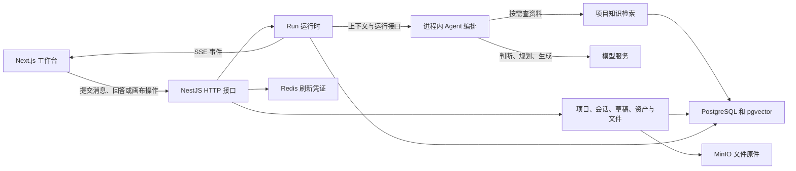
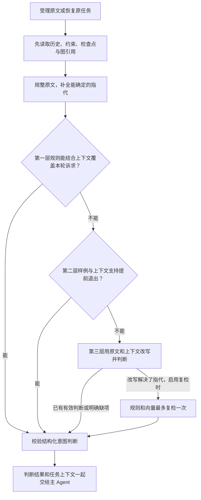
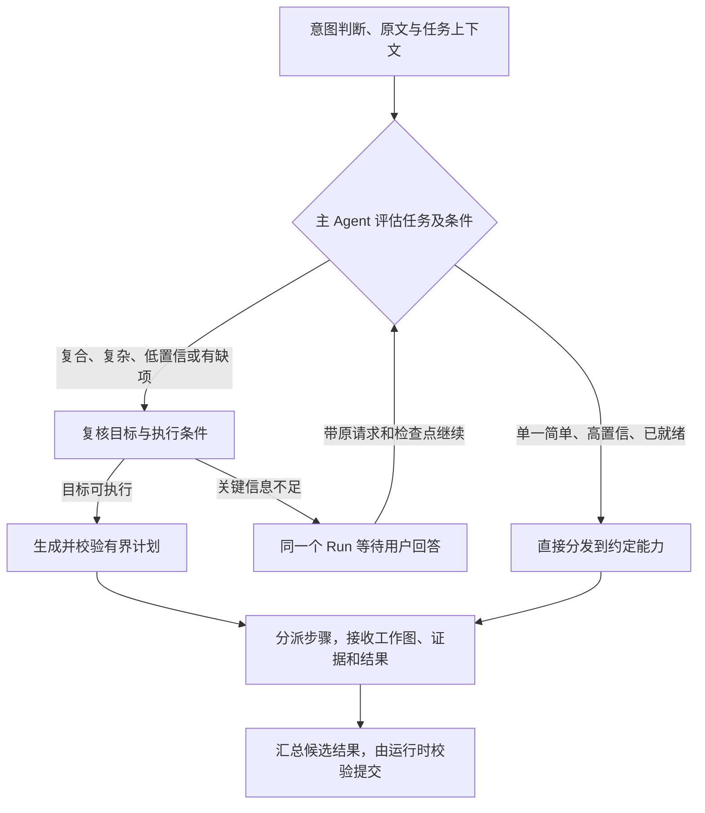

# ArchFlow 系统架构与 Agent 编排设计

ArchFlow 的产品闭环是 **提出 Idea → 澄清约束 → 生成或修改架构图 → 用户调整画布 → 保存为资产或沿历史分支继续**。一次 Agent 对话可以推进其中几步。项目、会话、画布和资产一起保存工作成果，让用户下一次打开时还能接着做。

**用户用一个入口提需求，后端先组装会话上下文，再做三层意图识别，由主 Agent 选择直接执行或有界规划。** 这是新编排的设计与隔离预览能力，尚未替换正式 `/api/v1` 的原有 Agent 流程。完整的应用编排还要检查输入条件、执行任务和汇总结果。外围的工作台、Run 运行时、知识库与图资产各有自己的职责和数据。本文是待评审设计，当前工作区对照见第 9 节。产品范围、接口和字段约束分别由既有文档及 Zod 定义。 [会话交接](Agent架构讨论交接.md) · [MVP 需求](mvp.md) · [API 文档](API文档/附录：接口总览.md) · [Zod schemas](../packages/shared/src/schemas)

## 1. 系统分层与部署边界

| 模块 | 接收什么 | 负责什么 |
| --- | --- | --- |
| 工作台 `apps/web` | 输入框、附件、澄清答案、画布事件 | 包装请求，显示阶段、回答、引用和卡片。React Flow 渲染图，Dagre 做自动布局 |
| 业务入口 `apps/api` | HTTP 请求、有身份的调用方 | 校验请求与归属，提供项目、会话、草稿、资产和文件操作。消息入口接受 Run，状态流回到同一个对话界面 |
| Run 运行时 `apps/api` | 已受理的消息或继续执行的请求 | 分配 Run 和助手消息，读取状态，调用 Agent。管并发、幂等、等待、取消、提交、流式传输与恢复 |
| Agent 引擎 `packages/agent` | 原文、近期对话、项目约束、当前图和允许调用的能力 | 识别目标，检查前置条件，选择直接执行或有界规划。返回候选文本、引用、约束更新与图，或返回需回答的问题 |
| 模型与知识适配 | 一项具体任务和该任务所需的数据 | 通过原生 SDK 调用模型。检索适配器按项目权限返回可引用片段，编排层把片段交给需要它的任务 |
| 数据和契约 `packages/db`、`packages/shared` | 业务状态与跨包数据 | TypeORM 实体和迁移定义落库方式。共享 Zod 定义 HTTP、事件、意图、计划、图等结构 |

MVP 后端是模块化单体，Agent 和 NestJS 运行时同进程。主 Agent 是统一调度者，子 Agent 可以先表现为带输入输出契约的进程内能力。MinIO 存上传原件，PostgreSQL 存业务记录与向量，Redis 的 MVP 职责是刷新凭证等短期数据。RabbitMQ、Go 文档解析服务及开放的工具接入属于后续演进。 [项目开发规范](../AGENTS.md) · [架构规划](架构规划.md)

## 2. 从用户输入到编排上下文

1. 用户在一个聊天框输入原文，可选附上项目文件。若画布有待保存的修改，正式链路先以 `baseVersion` 保存，留给本轮一个明确的工作基线。
2. 正式消息入口校验身份、会话与附件归属，按 `Idempotency-Key` 受理。新任务创建用户消息、助手占位及 Run，返回 `202`、`runId` 和 `streamUrl`。重复提交同一个请求返回原受理结果。同一会话同一时刻只处理一个 Run。回答等待中的问题时，以检查点和答案恢复原任务。 [正式对话数据流](数据流.md#流-4核心对话与-sse-流式推演-agent-run)
3. **进入第一层之前**，运行层组装本轮 `AgentTurn`。编排层用这份输入识别与当前请求有关的历史、引用和未解决问题，准备入口改写。第一层判断时同时看当前输入和这些会话线索。其后的向量匹配、LLM 兜底与主 Agent 沿用同一个任务上下文，各取需要的部分。 [现有编排契约](../packages/shared/src/schemas/orchestration.schema.ts)

| 数据 | 进入路由时怎么用 | 后续怎么用 |
| --- | --- | --- |
| 当前用户原文 | 判断本轮动作、否定、顺序、数量和证据要求。当前轮与历史消息分别传入 | 校对改写与计划是否漏掉原始诉求，保存为用户消息 |
| 近期的用户和助手消息 | 查上轮任务、最近讨论过的对象和明确指代。初始窗口最多 10 条消息，优先保持问答轮次完整，受长度预算约束 | 调度用与本轮有关的部分补齐任务，执行时按任务裁剪。助手提出的假设仍需用户确认 |
| 本会话已确认的约束和待回答的问题 | 从 `agent_states` 读项目目标、人数、部署环境等确认过的事实，恢复时再结合原任务与检查点 | 调度判断缺哪些条件，执行保留这些约束。即使“团队 3 人，单机部署”已离开历史窗口，它依然有效 |
| 工作台对象与版本 | 依据明确选中的图、节点、历史快照或已授权附件补齐对象。可用会话草稿及 `draftVersion` 判断目标是否存在 | 读取明确的图版本，生成或应用补丁。提交前复核草稿版本，检索时使用已授权的项目与附件范围 |

例如，上一轮只有一张明确引用的校园交易图，本轮说“只解释刚才那张图”。入口能用历史消息、图引用和草稿版本把它定位到明确对象，第一层就可以认出这是一项只读解释。如果历史中有两张图且指代无法唯一解析，记录候选对象和疑点交给后续判断。上下文越长，越需要保留来源和裁剪范围。作答涉及较早的约束应优先读结构化状态。长会话摘要和跨会话记忆另行评估。 [会话记忆设计](架构规划.md#1-记忆)

## 3. 三层意图识别与有限重跑

### 3.1 入口预处理与三个判断层

| 步骤 | 具体做法 | 什么时候交给下一步 |
| --- | --- | --- |
| 入口预处理与轻量改写 | 读取第 2 节的上下文后保留原文，规整用于匹配的文本。规则能确定时，补上历史中的目标、选区或附件指代。保留“不”“只”“先”“再”、数字和引用 | 向第一层提供本轮原文、规范化文本、可确定的指代和待解歧义。需要模型理解的省略稍后处理 |
| 第一层规则匹配 | 用关键词定位候选，用整句模式、上下文与对象校验整个请求。上轮只有一张明确引用的图，“只解释刚才那张图”可以绑定对象并命中 | 可靠命中就交给主 Agent。只有部分命中、存在第二个动作、指代冲突或否定使规则无法确认时继续第二层 |
| 第二层意图样例向量 | 用本轮语义和入口补全的对象匹配已标注意图的问法。检查最高相似度、它和其他意图的差距、上下文是否一致 | 可靠覆盖整个请求才提前退出。初期优先评估明确的只读意图。向量不可用、边界模糊或复合请求覆盖不足时进入第三层 |
| 第三层 LLM 兜底 | 复用入口已载入的原文与近期历史，结合约束、图摘要和附件指代。一次调用给出完整改写、动作、对象、参数、约束、复杂度、资料依赖和疑点 | 结构化判断足够时直接送审。若选择用改写复检，则回到规则和向量最多一次。复检仍有疑点就交给主 Agent 澄清 |

优先用程序完成第一遍改写，简单指代或明确模板可以在 LLM 之前处理。如果入口选择调用 LLM 完成完整改写，建议同一次调用给出意图候选，避免第三层再做相同工作。用户原案是改写后重跑。此前建议是当兜底已经给出有效判断便直接调度，需要验证时才复检。若启用复检，沿用同一份上下文并禁止回到第三层。复检结果须保留原文和第三层已确认的动作、否定与依赖。两种策略用同一批样例评测后再定。

### 3.2 交给调度的判断结果

三层用同一种结构交接。目标设计沿用 `AgentDecision` 的角色，实际字段由下一轮评审决定。判断结果记录完整任务文本、动作及对象、约束和来源、相关历史或图引用、证据依赖、复杂度、路由层和命中依据、未确定项。主 Agent 同时接收原 `AgentTurn`，可以复核改写，也可从中取得计划和执行所需的数据。意图层只认出了部分动作时，判断结果要显式保留未覆盖的部分。

意图、复杂度、置信度和前置条件分别判断。“画个架构图”的类别可以很明确，同时因缺项目目标而无法执行。“把缓存移到网关前，再拆分订单服务”可能只有 `edit_graph` 这一意图类别，但仍包含两个需协调的动作。向量相似度用来衡量候选接近程度，直接执行门槛应按真实样本校准。LLM 输出经过结构化校验后才进入下一阶段。 **到这里，意图识别完成。** [当前路由](../packages/agent/src/router.ts) · [当前判断结构](../packages/shared/src/schemas/orchestration.schema.ts)

## 4. 主 Agent 的两条执行路径

主 Agent 是统一协调者。它用意图判断和原任务上下文检查能力、权限、对象、前置条件及预算，把每个步骤交给合适的子 Agent 或执行单元。第一层已经完整识别且满足直达条件时，主 Agent 可以按规则直接分发。执行单元仍可以调用 LLM 生成图、补丁或解释。需要动态安排步骤时，主 Agent 才调用规划模型。两条路径共用知识检索、模型适配、输出契约和运行状态。

| 决策 | 条件 | 行为 |
| --- | --- | --- |
| 直接执行 | 单一、简单、置信度足够，且关键输入齐全 | 调用一个已知能力。例如“解释当前图”携带现有 `Graph` 进入解释能力，仍可调用 LLM 组织回答 |
| 先判断再规划 | 多动作、依赖复杂或置信度不足 | 主 Agent 复核任务。目标和对象可以确定时，生成有上限的步骤，校验目标覆盖、能力白名单、输入依赖和执行预算后开始。缺少会改变结果的关键信息时先澄清 |

“等待澄清”是 Run 的状态，属于分支 B 的前置处理。已明确要生成图但项目目标为空，或者要求修改图但当前会话没有草稿，都要先取得输入。把“给缓存加 Redis”理解成要改图也仍需检查目标节点和修改范围。可以通过问题或约束卡片拿到答案，并恢复同一 Run。若新答案补足对象或改变任务范围，主 Agent 基于更新后的上下文重新检查，可转入直接执行。

首批能力可以按下表理解。主 Agent 给每项能力传必要的任务、状态和证据，能力执行后返回候选结果。

| 能力 | 主要输入 | 产物 |
| --- | --- | --- |
| `generate_graph` 生成图 | 项目目标、确认约束、适用证据 | 新的候选节点和连线、说明 |
| `edit_graph` 改图 | 当前工作图、修改范围、保留约束 | `GraphPatch` 和变更说明。未改节点保留 ID |
| `explain_graph` 解释图 | 明确的图版本、要解释的部分、适用证据 | 结构或数据流说明，必要时带引用 |
| `query_knowledge` 查资料 | 项目范围、任务需要查证的问题和附件 | 相关片段与来源，可供回答或后续图任务使用 |
| `general_chat` 通用问答 | 问题和相关上下文 | 文本回答 |

例如“加 Redis 做商品缓存，再解释加完后的读写路径”，第二步必须读取本轮修改后的工作图。计划在临时 `workingGraph` 上传递图和中间结果，最后提交一次。计划无法覆盖请求、越过能力边界、超过预算或缺少必要的上游产物时，明确哪些目标暂时无法完成。若本次改图被跳过，依赖它的解释也应标为未完成。可先用顺序计划表达这些依赖，显式记录步骤需要的前序产物。并行执行留给确有独立输入和产出的任务。 [现有调度与执行代码](../packages/agent/src/engine.ts)

**运行中仍有一次决策。** 执行单元按任务返回完成情况、产物、来源与失败原因，主 Agent 据此决定继续、有限补查、澄清或结束。缺目标或对象要问用户。没有找到用户指定的资料时，可以评估同一授权范围内补查，拿不到证据就说明依赖步骤未完成。工具超时用执行失败的语义处理。如果直接路径发现需要持续查证，可评估同一 Run 内升级到有界规划，交接原任务、当前图和版本、已有证据、已完成步骤和剩余预算。触发条件与次数上限需要单独验收，重试应避免重做已提交的修改。

需要调用模型时，识别、规划和产出使用各自的提示词及输出契约。识别使用原文及必要的会话状态，模型给出结构化判断。规划使用已识别目标和能力清单，模型给出步骤。执行使用单项任务、已确认约束、目标图或相关证据，模型返回文字、图或补丁。运行记录可以追踪出错的是识别、步骤选择还是结果生成。 [提示词设计](架构规划.md#11-提示词) · [模型适配](../packages/agent/src/llm/openai.ts)

## 5. 知识库在什么时候参与

**入库发生在上传之后。** 可解析的项目文本被提取、清洗、切片和向量化，经 `documents_chunks` 写入 pgvector 后变成 `ready`。图片的目标链路先提取文字说明。MinIO 保留上传原件。MVP 的 PDF 和 DOCX 仅存储，状态为 `stored`。 [文件数据流](数据流.md#流-9文件上传与解析-files) · [入库设计](架构规划.md#12-rag)

**检索发生在具体任务要取证时。** 编排层为需要资料的步骤形成查询，检索适配器按当前项目、授权附件和 `ready` 过滤，从候选片段里返回相关内容与来源。执行模型用这些片段解释或生成，最终引用绑定到返回的来源。路由向量比较的是“这句话像哪个意图”，项目 RAG 的向量比较的是“哪些文档段落能为本任务提供依据”。

| 用户诉求 | 库里没有合适片段时 |
| --- | --- |
| “为校园二手交易平台画一张初稿” | 可以根据已给约束和模型知识生成，未给出的条件标作假设 |
| “解释当前图里的商品查询链路” | 使用当前图给出结构说明 |
| “按我上传的缓存规范改图” | 明确说明没有找到可用依据，暂停或跳过依赖该规范的改图 |
| 未来的公开网页检索 | 搜索排名给出候选来源。抽取、筛选、综合及引用仍属于执行阶段。这条链路留在 MVP 之后评估 |

无命中和检索服务失败需要区分。前者说明当前范围里缺证据，后者说明本次无法完成查询。显式依赖资料的任务应让用户知道实际发生了哪一种。 [当前项目检索适配器](../apps/api/src/modules/run/knowledge-search.ts)

## 6. Run、画布与产品结果

**Run 管一轮执行。** 正式流程从 `queued` 到 `running`。需要用户补输入时进入 `waiting_input`，把原始任务和检查点保存在 Run 中，发 `interrupt` 后关闭当前 SSE。普通文字或卡片回答可以恢复同一个 `runId` 和 `assistantMessageId`。答复按 `interruptId` 去重。`succeeded`、`failed`、`canceled` 是终态，用户可以主动取消，等待超时也可以结束该 Run。卡片展示和答题记录归消息，等待哪一步归 Run，跨轮保留的会话约束归 `agent_states`。 [Agent API](<API文档/5. Agent.md>) · [卡片 API](<API文档/6. 卡片 Cards.md>)

**SSE 传递阶段、文本和已提交的图。** 客户端拿到 `streamUrl` 后订阅，先收 `run-start`，按实际经过的步骤收 `status`、`text-delta`、引用等帧。主结果提交后推送图和 `done`。连接断开时 Run 继续执行。内存缓冲有效时，客户端按 `Last-Event-ID` 补帧。缓冲过期时，服务端从 `runs` 与 `messages` 重建可展示的结果。工作进程故障后的自动重执行需要额外的执行恢复机制。 [SSE 事件与恢复契约](<API文档/5. Agent.md#52-获取流sse>)

**图生成和保存是两个交接点。** 新编排的 Agent 产出结构化图或补丁，校验节点 ID、边端点等结构。运行时在提交前检查读取时的 `draftVersion`。若用户已保存新版画布，给这轮 Run 记录 `DRAFT_VERSION_CONFLICT`，用户的新草稿仍然可用。前端编辑保存同样带 `baseVersion`，正式草稿接口在冲突时返回 `409`。图 schema 不含拖拽坐标；上游已实现独立的 `conversation_canvas_layouts` 与 GET/PUT layout，拖拽结束保存并在刷新后还原。新图补丁接入该布局层的行为仍需验证。 [图契约](../packages/shared/src/schemas/common.schema.ts) · [布局接口](<API文档/4. 会话 Conversations.md#48-画布布局>)

| 用户看到的图 | 权威数据 | 生命周期 |
| --- | --- | --- |
| 右侧当前草稿 | `conversations.current_draft_graph` 与 `draft_version` | 这个会话正在编辑的图，允许用户或 Agent 按版本更新 |
| 历史消息的图 | `messages.graph_snapshot` | 保留某次输出时的图。恢复快照时以它覆盖当前草稿并按版本保存 |
| 左侧已保存资产 | `assets.graph_data` | 用户主动保存的项目成果，可以独立加载 |
| 历史分支 | 新会话及复制的历史消息和源图 | 以历史消息为起点继续，后续修改留在新会话 |

**标题和推荐问题是会话辅助结果。** 原设想是在主任务生成期间并行启动两项。建议在首个有效任务已明确时起标题，按会话与版本写回并保护手动标题。推荐问题按 `runId` 和助手消息绑定，建议用提交后的实际回答、图和未解项生成，写入 `metadata.suggestedQuestions`。若在生成期间提前计算，则等主结果提交后再校验并发布。主 Run 提交后即可完成，辅助任务独立记录成败。 [现有辅助结果契约](<API文档/5. Agent.md>) · [图与快照数据流](数据流.md#流-6画布编辑与乐观锁防抖-draft-save)

## 7. 一条完整的工作台对话

| 用户行为 | 内部发生的事 | 用户最终看到什么 |
| --- | --- | --- |
| 输入“画个架构图” | 创建 Run A，先读会话状态，规则识别生成图。主 Agent 发现项目目标缺失，保存检查点并等待输入 | “你想给什么系统画图？”或相应约束卡片 |
| 回答“校园二手交易平台，团队 3 人，单机部署” | 恢复 Run A，把答案与原画图任务、已知状态合在一起重新检查。直接调用生成能力，校验并提交草稿 `v1`。目标明确后可并发拟标题，提交后派生推荐问题 | 一张可查看的初稿、解释，以及稍后回写的推荐问题 |
| 输入“只解释刚才那张图” | 创建 Run B。第一层用入口读取的上轮信息和图引用绑定 `v1`，完整命中解释意图。主 Agent 直调 `explain_graph` | 对 `v1` 的解释，画布保持 `v1` |
| 输入“按项目里的缓存规范给商品查询加 Redis，订单链路保持不变，再解释改完的读写路径” | 创建 Run C。沿用项目约束和 `v1`，改写保留否定、资料要求和两个动作。计划查询规范、修改 `v1` 的临时图、解释改后的图。结果合法且草稿还是 `v1` 时提交 `v2` | 更新后的图、商品查询说明和规范引用。规范缺失时说明改图的必要依据缺在哪 |
| 在 Run C 执行途中手动保存新版图 | 手动保存先更新草稿版本。Run C 提交时发现基线变化 | 保留用户保存的图，展示冲突，可基于新图重新执行 |
| 满意后点“保存资产”，或从旧消息“开新分支” | 资产接口复制选中的图为项目成果。Fork 根据所选消息及当时图创建独立会话 | 保存的图出现在项目树里，或进入另一条可继续编辑的会话 |

初次画图依据用户给出的事实，只读解释使用已定位的图。加 Redis 的请求显式要求依据缓存规范，才会用到项目 RAG。其中“再解释”依赖这次改图的产物，主 Agent 用有界计划协调两步。 [核心业务数据流](数据流.md)

## 8. 验收和待取舍的设计

评测样例同时给出历史、当前画布、用户原文、预期意图、执行方式、证据依赖和预期结果。用同一轮“只解释刚才那张图”配一张和两张候选图，验证前者可在第一层绑定对象、后者须继续判断或追问。覆盖否定、跨历史窗口的已确认约束、同一意图中的多动作、复合步骤依赖、无资料、工具失败、重复提交、断线续传和草稿冲突。对比“三级级联”和“单次 LLM 路由”，再在级联实验中比较兜底后是否复检。追踪错误早停、漏任务、澄清次数、图与引用正确率、首包延迟、模型调用与 token 数。用 `traceId` 关联本轮使用的上下文来源、路由原因、计划步骤、检索命中和提交结果。 [评测规划](架构规划.md#7-可评估) · [待做清单](待做清单.md)

| 需要取舍的点 | 评审草案 | 决策依据 |
| --- | --- | --- |
| 上下文窗口与首次改写 | 上下文从第一层开始使用。先对齐最近 10 条消息的边界、明确引用和已确认约束。入口优先轻量改写，需模型解歧义时复用一次 LLM 的改写和判断 | 比较指代命中率、完整轮次保留率、首包延迟及模型调用 |
| LLM 改写后是否重跑 | 原案在改写后重走。建议先比较直接使用结构化判断与最多复检一次前两层。两种路径都复用原文及上下文 | 是否减少误路由，同时保留否定、复合目标和附件依赖 |
| 自动直达的门槛 | 按规则、样例向量与 LLM 分别校准把握程度。明确的只读意图优先验证提前退出，写操作检查对象和约束 | 误执行和误修改的代价高于多一次澄清。是否值得扩到写任务由评测决定 |
| 执行中升级 | 先让直达和有界计划共用执行能力。定义无证据、归属冲突、超时等结果，再决定何时带已有结果升级 | 比较补查收益、剩余预算和重复执行的代价 |
| 子 Agent 的边界 | 初期共用运行时，按能力契约拆分。单个能力有独立上下文、工具或部署需求时再做边界调整 | 多调用一次模型、增加数据交接和部署的成本，与隔离和独立演进的收益对照 |
| 标题和推荐问题的时机 | 标题可在目标稳定后提前启动，推荐问题优先使用最终提交的结果 | 首次展示速度、标题过早定性、推荐问题是否贴合最终图 |
| 拖拽位置是否持久化 | 若保留刷新复原的体验验收，单独确定布局字段及其版本关系 | 画布位置是用户编辑结果，图节点和连线继续遵循既有语义图契约 |

## 9. 当前工作区与设计的差异

下表对照本地工作台、Agent 引擎及正式接线的进度。早期讨论以 `7b80797` 为基线。 [待做清单](待做清单.md)

| 环节 | 当前已具备 | 待评审或待接入 |
| --- | --- | --- |
| Web 请求与展示 | 默认正式 `/api/v1` 已有鉴权、消息 SSE、可拖拽并保存布局的画布及资产/分支；`MOCK_API=1` 时同源 Mock 提供新编排预览、历史图提问 | 新预览体验接入正式入口并回归鉴权与布局 |
| 意图识别 | 运行层装载历史、约束、草稿和明确选择的历史图。提到旧版本但未选图时先追问。整句规则和意图向量主要匹配本轮文本，向量候选提前退出限于解释图和查资料。LLM 兜底使用近期历史判断、改写 | 从对话自动定位历史图、向量层复用入口补全的语义、改写后按条件复检、跨层置信度和真实模型评测 |
| 调度和能力 | 直接执行条件是单一意图且 `simple`。复杂任务用有上限的顺序计划传递临时工作图。改图后的解释超时时，如时间允许，使用临时图重试一次。必需资料缺失时结束依赖它的改图和解释 | 更通用的动作依赖和失败传播、运行中升级的边界、进程内能力的边界 |
| Run 与提交 | 上游正式 `RunModule` 已有 HTTP/SSE、缓冲重放与原有 HITL；Mock 运行时按账号保存预览结果；新增 `AgentRunService` 实现另一套受理、恢复和版本检查 | 将新服务与正式驱动整合。单活跃 run 迁移文件暂未注册，不能以其推断正式运行具备数据库唯一约束；激活前验证并发、迁移和重放兼容性 |
| 知识 | 上游正式链路已有文件上传、文本入库、RAG 与引用；新检索适配器可按项目、`ready` 状态和附件过滤，开发预览未注入该适配器 | 新编排接入正式项目检索，图片解析和真实模型效果待验证 |
| 异步辅助 | 工作区实现可在主结果提交后独立生成标题和推荐问题 | 提前启动标题的策略和对应 UI 时机仍可评审 |

实现入口见 [Web 发送](../apps/web/hooks/use-send-message.ts)、[Mock 运行时](../apps/web/lib/mock-run-runtime.ts)、[开发预览](../apps/web/lib/preview-agent.ts)、[意图路由](../packages/agent/src/router.ts)、[Agent 引擎](../packages/agent/src/engine.ts)、[NestJS Run 服务](../apps/api/src/modules/run/agent-run.service.ts) 和 [知识检索](../apps/api/src/modules/run/knowledge-search.ts)。
